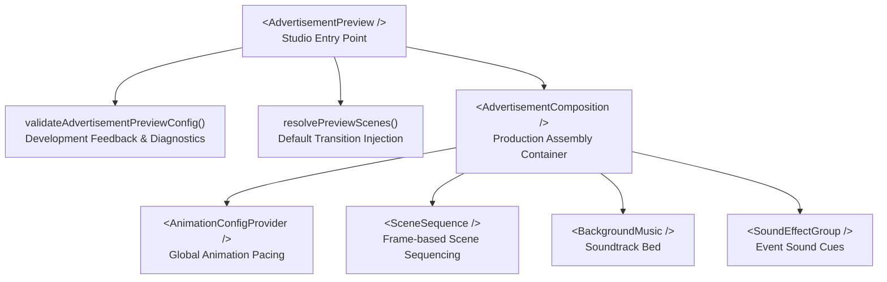

# AdvertisementPreview Component

A reusable preview entry point for assembling, testing, and previewing complete commercial advertisements inside Remotion Studio and CI rendering pipelines.

---

## 1. Overview & Objectives

`AdvertisementPreview` serves as the primary developer-facing preview wrapper for the Layer 4 Advertisement Assembly Pipeline. It combines `AdvertisementComposition`, `SceneSequence`, transitions, audio layers, and `GlobalAnimationConfig` into a single declarative API.

### Core Architecture:
- **100% Deterministic Parity**: Renders directly through `AdvertisementComposition`, guaranteeing identical visuals, frames, and audio mixing between preview and exported MP4 video.
- **Integrated Transition Settings**: Automatically injects unified transition defaults (`fade`, `wipe`, `slide`, `zoom`) across scenes lacking explicit transitions via `transitionSettings`.
- **Integrated Audio Beds & SFX**: Natively accepts `backgroundMusic` and `soundEffects` alongside visual scenes.
- **Development-Time Diagnostics**: Includes an interactive Telemetry HUD overlay (`debug = true`) and bottom Timeline Scrubber (`showTimeline = true`) displaying live frame counters, SMPTE timecode, active scenes, and validation warnings.
- **Zero-Failure Onboarding**: Displays an informative development guide when scenes are empty, eliminating blank-screen confusion.



---

## 2. API Specification

### AdvertisementPreviewProps

| Prop | Type | Default | Description |
| :--- | :--- | :--- | :--- |
| `width` | `number` | `1920` | Canvas width in pixels (defaults to 1080p landscape). |
| `height` | `number` | `1080` | Canvas height in pixels (defaults to 1080p landscape). |
| `fps` | `number` | `30` | Frame rate in frames per second. |
| `durationInFrames` | `number` | Computed sum | Total duration in frames. Auto-calculated from scenes if omitted. |
| `background` | `string` | `undefined` | CSS background gradient or pattern. |
| `backgroundColor` | `string` | `Colors.dark.bgPrimary` | Solid background color override. |
| `backgroundContent` | `React.ReactNode` | `undefined` | Custom background element rendered behind all scenes. |
| `scenes` | `SceneSequenceItemConfig[]` | `[]` | Array of scene configurations to sequence. |
| `transitionSettings` | `PreviewTransitionSettings` | `undefined` | Default transition type, duration, and easing for scenes. |
| `animation` | `GlobalAnimationConfig` | `undefined` | Centralized animation config (speed multiplier, reduced motion). |
| `backgroundMusic` | `BackgroundMusicProps` | `undefined` | Continuous soundtrack bed configuration. |
| `soundEffects` | `SoundEffectProps[]` | `undefined` | Sound effect cue triggers scheduled along the timeline. |
| `audio` | `AudioTrackConfig \| AudioTrackConfig[]` | `undefined` | Additional raw audio tracks. |
| `safeArea` | `boolean \| number` | `true` | Broadcast safe area boundary overlay (60px default). |
| `padding` | `ScenePadding` | `undefined` | Inner layout padding. |
| `debug` | `boolean` | `false` | Displays visual HUD overlay with SMPTE timecode & errors. |
| `showTimeline` | `boolean` | `false` | Displays bottom timeline scrubber bar. |
| `title` | `string` | `'Advertisement Preview'` | Title or campaign label displayed in preview HUD. |
| `compositionId` | `string` | `'ad-preview'` | Unique composition identifier for profiling. |
| `style` | `React.CSSProperties` | `undefined` | Inline style overrides. |
| `className` | `string` | `undefined` | CSS class name. |
| `children` | `React.ReactNode` | `undefined` | Direct children rendered alongside or within the composition. |

---

## 3. Usage Examples

### Example 1: Minimal Two-Scene Spot Preview

```tsx
import React from 'react';
import { AdvertisementPreview } from './compositions/advertisements';
import { HeroScene, CallToActionScene } from './components/scenes';

export const MinimalAdPreview: React.FC = () => {
  return (
    <AdvertisementPreview
      title="Minimal 2-Scene Commercial"
      compositionId="minimal-spot"
      transitionSettings={{ defaultType: 'fade', defaultDurationInFrames: 15 }}
      scenes={[
        {
          id: 'hero',
          durationInFrames: 60,
          scene: <HeroScene headline="Launch Faster" />,
        },
        {
          id: 'cta',
          durationInFrames: 60,
          scene: <CallToActionScene headline="Start Your Free Trial" />,
        },
      ]}
      debug={true}
      showTimeline={true}
    />
  );
};
```

### Example 2: Full Audiovisual Commercial Preview

```tsx
import React from 'react';
import { staticFile } from 'remotion';
import { AdvertisementPreview } from './compositions/advertisements';

export const AudiovisualPreview: React.FC = () => {
  return (
    <AdvertisementPreview
      title="Commercial Showcase"
      compositionId="audiovisual-ad"
      animation={{
        speedMultiplier: 1.25,
        defaultDuration: 15,
      }}
      backgroundMusic={{
        src: staticFile('audio/ambient_score.mp3'),
        volume: 0.75,
        fadeInFrames: 20,
        fadeOutFrames: 30,
      }}
      soundEffects={[
        { triggerFrame: 15, preset: 'whoosh' },
        { triggerFrame: 60, preset: 'ui-click' },
        { triggerFrame: 120, preset: 'notification' },
      ]}
      scenes={[
        // Sequenced scenes with auto-injected transitions
      ]}
      debug={true}
      showTimeline={true}
      safeArea={true}
    />
  );
};
```

### Example 3: Remotion Studio Root Registration

In `src/Root.tsx`:

```tsx
import { Composition } from 'remotion';
import { AdvertisementPreview } from './compositions/advertisements';

export const RemotionRoot: React.FC = () => {
  return (
    <Composition
      id="AdvertisementPreview"
      component={AdvertisementPreview}
      durationInFrames={180}
      fps={30}
      width={1920}
      height={1080}
      defaultProps={{
        title: "Studio Ad Preview",
        debug: true,
        showTimeline: true,
      }}
    />
  );
};
```

---

## 4. Testing & Verification

Unit tests in `tests/advertisement-preview.test.ts` verify:
- Complete configuration validation (positive dimensions, valid frame rates, duration bounds).
- Catching missing scene IDs and non-positive durations with actionable error messages.
- Automatic transition injection into scenes without explicit transitions.
- Total duration calculation from scenes and delay offsets.
- Detection of audio layers (`backgroundMusic`, `soundEffects`, `audio`).
- Forwarding and validation of `GlobalAnimationConfig`.
