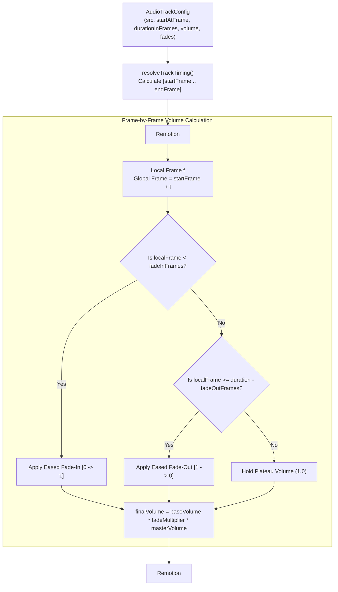

# AudioTrack Documentation

`AudioTrack` is a reusable, frame-accurate Remotion audio management component for positioning and configuring audio layers independently from visual scenes. It supports audio stems, background music beds, voiceovers, and sound effects with automated volume fade envelopes, playback rate scaling, ducking, and looping.

---

## 1. Key Capabilities

- **Frame-Accurate Remotion Audio**: Uses Remotion's `<Audio />` primitive and deterministic volume automation functions with zero floating-point timing drift.
- **Independent Timeline Positioning**: Audio tracks can start at arbitrary frame offsets (`startAtFrame`), run for explicit durations (`durationInFrames`), or span the remaining composition duration.
- **Automated Fade Envelopes**: Built-in cubic bezier and linear fade-in and fade-out curves. Proportional scaling prevents volume clipping when fade duration exceeds track lifespan.
- **Dynamic Volume Automation**: Supports static numeric multipliers (`0.0` to `1.0+`) or dynamic frame functions (`(frame, metrics) => number`).
- **Multi-Track Orchestration & Ducking**: `AudioTrackGroup` mixes multiple stems together and automatically ducks background music beds when voiceover narration is active.
- **Playback Rate & Pitch Control**: Supports variable playback speeds (`playbackRate`) with `preservePitch` preservation.
- **Safe Offline & Test Fallbacks**: Includes `SILENT_AUDIO_DATA_URI` and `toneFrequency` to ensure test suites, previews, and CI/CD pipelines run without network requests or missing MP3 errors.
- **Seamless Advertisement Composition Compatibility**: Integrated directly into `AdvertisementComposition` and synchronized with `TimelineManager`.

---

## 2. Architecture & Lifecycle



---

## 3. API Reference

### `AudioTrackConfig`

```typescript
export interface AudioTrackConfig {
  /** Audio source file path, URL, staticFile reference, or data URI */
  src: string;
  /** Optional unique identifier for logging, telemetry, and ducking */
  id?: string;
  /** Human-readable track label for timeline inspection and debugging */
  name?: string;
  /** Frame at which the audio track begins playing in the composition (default: 0) */
  startAtFrame?: number;
  /** Alias for startAtFrame */
  startFrame?: number;
  /** Total playback duration allocated in frames. If omitted, spans to composition end */
  durationInFrames?: number;
  /** Ending frame boundary in composition timeline (alternative to durationInFrames) */
  endFrame?: number;
  /** Trim offset into the source audio file in frames */
  trimBefore?: number;
  /** Base volume multiplier (0.0 to 1.0, or custom dynamic function, default: 1.0) */
  volume?: AudioVolumeProp;
  /** Playback speed multiplier (e.g. 0.5 to 2.0, default: 1.0) */
  playbackRate?: number;
  /** Preserves audio pitch when playbackRate is altered (default: true) */
  preservePitch?: boolean;
  /** Loops audio playback continuously throughout its allocated duration (default: false) */
  loop?: boolean;
  /** Explicit duration of the loop cycle in frames when looping custom segments */
  loopDurationInFrames?: number;
  /** Duration in frames for initial volume fade-in from 0 to target volume (default: 0) */
  fadeInFrames?: number;
  /** Duration in frames for final volume fade-out to 0 (default: 0) */
  fadeOutFrames?: number;
  /** Easing curve preset or function applied to the fade-in volume envelope (default: 'linear') */
  fadeInEasing?: EasingPresetName | EasingFunction;
  /** Easing curve preset or function applied to the fade-out volume envelope (default: 'linear') */
  fadeOutEasing?: EasingPresetName | EasingFunction;
  /** Completely mutes audio playback (volume = 0) while keeping timing active */
  muted?: boolean;
  /** Completely disables the audio track, preventing it from mounting */
  disabled?: boolean;
  /** Clamps track duration so it never overflows past composition end (default: true) */
  clampToComposition?: boolean;
  /** Synthesizer test tone frequency in Hz (for previews without external audio files) */
  toneFrequency?: number;
}
```

### `AudioVolumeMetrics`

```typescript
export interface AudioVolumeMetrics {
  globalFrame: number;
  localFrame: number;
  baseVolume: number;
  fadeMultiplier: number;
  finalVolume: number;
  isFadingIn: boolean;
  isFadingOut: boolean;
  isMuted: boolean;
  phase: 'pending' | 'fadeIn' | 'hold' | 'fadeOut' | 'complete';
}
```

### `AudioTrackGroupProps`

```typescript
export interface AudioTrackGroupProps {
  tracks?: AudioTrackConfig[];
  masterVolume?: number;
  muted?: boolean;
  disabled?: boolean;
  ducking?: AudioDuckingConfig | AudioDuckingConfig[];
  debug?: boolean;
  children?: React.ReactNode;
}
```

---

## 4. Usage Examples

### Example 1: Single Ambient Track with Fade Envelopes

Plays a background track spanning the entire 150-frame composition with smooth 20-frame entrance and exit fades:

```tsx
import { AudioTrack } from './components/audio';

export const CommercialAudio: React.FC = () => {
  return (
    <AudioTrack
      src="https://example.com/ambient-bed.mp3"
      name="Background Ambient Bed"
      volume={0.8}
      fadeInFrames={20}
      fadeOutFrames={20}
    />
  );
};
```

### Example 2: Delayed Sound Effects Placement

Triggers an interface sound effect exactly at frame 45 without writing manual Remotion sequences:

```tsx
<AudioTrack
  src="https://example.com/chime.mp3"
  name="Card Reveal Chime"
  startAtFrame={45}
  durationInFrames={30}
  volume={0.9}
  fadeOutFrames={10}
/>
```

### Example 3: Voiceover Auto-Ducking Background Music

Automatically attenuates background music to 20% volume whenever the voiceover narration track is active:

```tsx
import { AudioTrackGroup } from './components/audio';

export const MultiTrackMix: React.FC = () => {
  return (
    <AudioTrackGroup
      masterVolume={1.0}
      ducking={{
        triggerTrackId: 'voiceover',
        targetTrackId: 'music-bed',
        duckedVolume: 0.2, // Ducks music to 20%
      }}
      tracks={[
        {
          id: 'music-bed',
          name: 'Background Music',
          src: '/assets/audio/cinematic-score.mp3',
          volume: 0.85,
          fadeInFrames: 15,
          fadeOutFrames: 15,
        },
        {
          id: 'voiceover',
          name: 'Voiceover Stem',
          src: '/assets/audio/voice-narration.mp3',
          startAtFrame: 30,
          durationInFrames: 90,
          volume: 1.0,
        },
      ]}
    />
  );
};
```

### Example 4: Dynamic Volume Curve with Custom Easing

Applies custom exponential easing curves to entrance and exit volume fades:

```tsx
<AudioTrack
  src="/assets/audio/drone.mp3"
  fadeInFrames={30}
  fadeOutFrames={30}
  fadeInEasing="easeInExpo"
  fadeOutEasing="easeOutExpo"
  volume={(frame) => (frame > 60 ? 0.9 : 0.5)}
/>
```

### Example 5: Looping Short Rhythm Stem

Repeats a short 30-frame drum stem continuously across 180 frames:

```tsx
<AudioTrack
  src="/assets/audio/drum-loop.mp3"
  loop={true}
  loopDurationInFrames={30}
  durationInFrames={180}
  volume={0.75}
/>
```

---

## 5. Verification & Quality Gates

The `AudioTrack` suite is strictly tested and verified against:
- **Unit Tests**: 21 unit tests in `tests/audio-track.test.ts` validating track timing calculation, volume interpolation, fade envelopes, ducking calculations, and data URI fallbacks.
- **Type Safety**: Strictly checked with TypeScript compiler (`tsc --noEmit --skipLibCheck`).
- **Remotion Bundler**: Webpack bundle passes cleanly with zero errors (`npx remotion bundle`).
- **Interactive Studio Showcase**: Tested and verified in `AudioTrackShowcase.tsx`.
