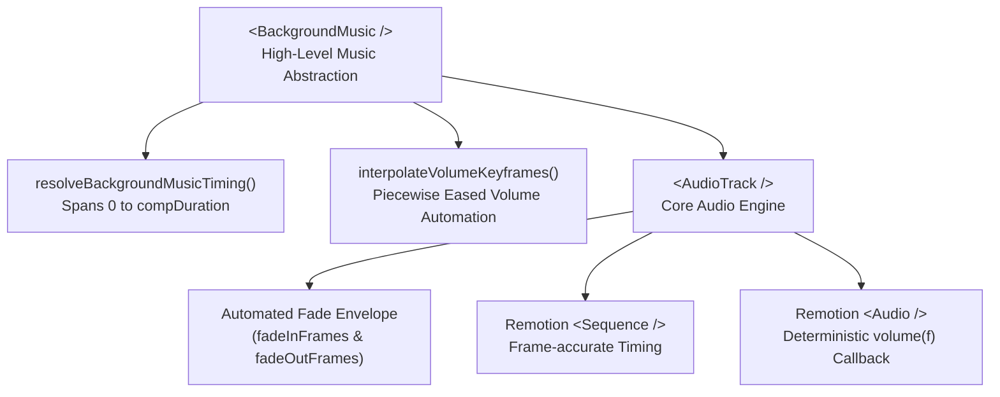

# BackgroundMusic Component

A production-ready, reusable background music abstraction built on top of `AudioTrack` for the Remotion Motion Graphics Framework.

---

## 1. Overview & Architecture

`BackgroundMusic` provides an expressive, high-level interface designed specifically for soundtrack scoring, ambient musical beds, and continuous rhythm cues within Remotion advertisement compositions.

Instead of duplicating low-level audio playback logic, `BackgroundMusic` specializes `AudioTrack` by providing:
- **Composition Spanning by Default**: Automatically stretches playback across the remaining composition duration when `durationInFrames` is omitted.
- **End-Frame Anchored Fade-Out**: Calculates fade-out boundaries backwards from the composition's end frame, preventing premature dropouts.
- **Seamless Looping**: Defaults `loop = true` for soundtrack loops and short rhythmic motifs.
- **Piecewise Volume Keyframing**: Supports deterministic volume automation (`VolumeKeyframe[]`) with easing curves (e.g. dipping music during voiceover and swelling back up).
- **Offline & CI Safety**: Bundles `SILENT_AUDIO_DATA_URI` and preview `toneFrequency` ensuring deterministic rendering even when external media assets are missing.



---

## 2. API Specification

### Props

| Prop | Type | Default | Description |
| :--- | :--- | :--- | :--- |
| `src` | `string` | `SILENT_AUDIO_DATA_URI` | Audio file path, URL, `staticFile` reference, or base64 data URI. |
| `id` | `string` | `'background-music'` | Unique track identifier for logging, telemetry, and ducking. |
| `name` | `string` | `'Background Music'` | Human-readable track label for timeline inspection. |
| `startFrame` / `startAtFrame` | `number` | `0` | Composition frame where background music starts playing. |
| `durationInFrames` | `number` | `compositionDuration - startFrame` | Duration in frames. If omitted, spans to composition end. |
| `endFrame` | `number` | `startFrame + durationInFrames` | Explicit end boundary in composition timeline. |
| `volume` | `number \| AudioVolumeFunction` | `0.7` | Nominal base volume multiplier (0.0 to 1.0+). |
| `fadeInFrames` / `fadeInDuration` | `number` | `0` | Entrance volume fade-in ramp duration in frames. |
| `fadeOutFrames` / `fadeOutDuration` | `number` | `0` | Exit volume fade-out ramp duration in frames. |
| `fadeInEasing` | `EasingPresetName \| EasingFunction` | `'easeInOutCubic'` | Easing curve applied to the entrance fade envelope. |
| `fadeOutEasing` | `EasingPresetName \| EasingFunction` | `'easeInOutCubic'` | Easing curve applied to the exit fade envelope. |
| `fadeToCompositionEnd` | `boolean` | `true` | Anchors fade-out envelope to the composition's end frame. |
| `loop` | `boolean` | `true` | Loops playback continuously across the track duration. |
| `loopDurationInFrames` | `number` | `undefined` | Duration of the loop cycle chunk when looping a short stem. |
| `keyframes` / `volumeKeyframes` | `VolumeKeyframe[]` | `undefined` | Keyframes for automated dynamic volume choreography. |
| `keyframesRelative` | `boolean` | `false` | When true, keyframe frames are relative to `startFrame`. |
| `playbackRate` | `number` | `1.0` | Playback speed multiplier (0.5x to 2.0x). |
| `preservePitch` | `boolean` | `true` | Preserves audio pitch when playback speed changes. |
| `masterVolume` | `number` | `1.0` | Master multiplier applied on top of final volume. |
| `enabled` | `boolean` | `true` | High-level enable toggle. If false, track is disabled. |
| `disabled` | `boolean` | `false` | Disables track and bypasses audio mounting. |
| `muted` | `boolean` | `false` | Sets audio output to 0 while keeping timing active. |
| `clampToComposition` | `boolean` | `true` | Prevents track from overflowing past composition end. |
| `toneFrequency` | `number` | `undefined` | Synthesizer test tone frequency in Hz (e.g. 240). |
| `debug` | `boolean` | `false` | Displays visual VU meter telemetry HUD overlay. |
| `showInTimeline` | `boolean` | `true` | Displays track sequence in Remotion Editor timeline. |
| `onVolumeCalculated` | `(metrics) => void` | `undefined` | Telemetry callback fired every frame. |
| `children` | `React.ReactNode` | `undefined` | Optional visual visualizer or waveform overlay elements. |

---

## 3. Volume Keyframes Specification

The `keyframes` prop accepts an array of `VolumeKeyframe` objects:

```typescript
export interface VolumeKeyframe {
  /** Global frame (or local frame if keyframesRelative is true) */
  frame: number;
  /** Target volume multiplier (0.0 to 1.0+) */
  volume: number;
  /** Optional easing curve when interpolating to this keyframe */
  easing?: EasingPresetName | EasingFunction;
}
```

### Interpolation Behavior:
1. **Before First Keyframe**: Holds the first keyframe's volume.
2. **Between Keyframes**: Evaluates normalized progress `t = (frame - f1) / (f2 - f1)` with easing applied.
3. **After Last Keyframe**: Holds the last keyframe's volume.
4. **Modulation**: The keyframed value smoothly scales nominal `volume`, while `fadeInFrames` and `fadeOutFrames` envelopes ramp cleanly from/to zero.

---

## 4. Usage Examples

### Example 1: Full Composition Ambient Soundtrack

```tsx
import React from 'react';
import { staticFile } from 'remotion';
import { BackgroundMusic } from './components/audio';

export const CommercialAd: React.FC = () => {
  return (
    <>
      {/* Visual scenes here */}

      {/* Automatically spans full composition with 30-frame fade-in and 45-frame fade-out */}
      <BackgroundMusic
        src={staticFile('audio/ambient_score.mp3')}
        volume={0.7}
        fadeInFrames={30}
        fadeOutFrames={45}
        fadeInEasing="easeInOutCubic"
        fadeOutEasing="easeInOutCubic"
      />
    </>
  );
};
```

### Example 2: Dynamic Speech Dip with Volume Keyframes

```tsx
import React from 'react';
import { staticFile } from 'remotion';
import { BackgroundMusic, AudioTrack } from './components/audio';

export const NarrationScene: React.FC = () => {
  return (
    <>
      {/* Background music dips from 80% to 20% while voiceover speaks */}
      <BackgroundMusic
        src={staticFile('audio/cinematic_bed.mp3')}
        volume={0.8}
        fadeInFrames={15}
        fadeOutFrames={30}
        keyframes={[
          { frame: 0, volume: 1.0 },
          { frame: 35, volume: 1.0 },
          { frame: 50, volume: 0.25, easing: 'easeInOutCubic' }, // Dip before narration
          { frame: 120, volume: 0.25 },                         // Low bed during speech
          { frame: 135, volume: 1.0, easing: 'easeInOutCubic' }, // Restore full volume
        ]}
      />

      {/* Voiceover narration track active between frames 45 and 125 */}
      <AudioTrack
        id="voiceover"
        src={staticFile('audio/voiceover.mp3')}
        startAtFrame={45}
        durationInFrames={80}
        volume={1.0}
        fadeInFrames={5}
        fadeOutFrames={10}
      />
    </>
  );
};
```

### Example 3: Looping Rhythm Stem

```tsx
import React from 'react';
import { staticFile } from 'remotion';
import { BackgroundMusic } from './components/audio';

export const FastPacedAd: React.FC = () => {
  return (
    <BackgroundMusic
      src={staticFile('audio/drum_loop_2s.mp3')}
      volume={0.85}
      loop={true}
      loopDurationInFrames={60} // Repeats every 2 seconds at 30 FPS
      fadeOutFrames={20}
    />
  );
};
```

---

## 5. Testing & Verification

Unit tests in `tests/background-music.test.ts` verify:
- Automatic composition spanning when `durationInFrames` is omitted.
- Remaining duration calculation when `startFrame > 0`.
- Clamping to composition end boundary (`clampToComposition = true`).
- Keyframe interpolation (linear, easing, hold before first, hold after last, relative offsets).
- Fade-out boundary compliance anchored to composition end frame.
- Proportional downscaling when `fadeIn + fadeOut > duration`.
- Mute, disable, and enabled toggles.
- Master gain scaling.
