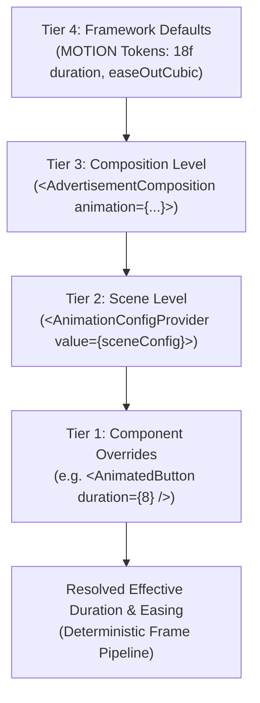

# GlobalAnimationConfig System

A centralized configuration system for managing animation behavior, timing conventions, speed multipliers, and reduced-motion modes across Remotion advertisement compositions.

---

## 1. Overview & Objectives

In large-scale commercial motion graphics, maintaining visual consistency across dozens of scenes, transitions, typography hero cards, and UI micro-interactions requires centralized control.

`GlobalAnimationConfig` allows developers to:
- **Set Composition Pacing**: Accelerate (e.g. 2.0x for snappy 15s commercial spots) or decelerate (0.5x for luxury cinematic intros) all animations via a single `speedMultiplier`.
- **Standardize Transition Durations**: Provide unified defaults for scene wipes, crossfades, and dissolves without manually coding frame lengths on every sequence.
- **Ensure Accessibility with Reduced Motion**: Enable `reducedMotion = true` to collapse all animation durations to 0, providing static previews and accessibility compliance.
- **Respect Component Autonomy**: Explicit props passed to individual components are never stomped, preserving custom design overrides.



---

## 2. The 4-Tier Precedence Hierarchy

Settings are resolved in strict order of specificity:

| Tier | Level | Mechanism | Scope |
| :--- | :--- | :--- | :--- |
| **Tier 1 (Highest)** | Component | Direct JSX prop (e.g. `duration={8}`) | Individual component instance |
| **Tier 2** | Scene | Nested `<AnimationConfigProvider>` | Scene subtree |
| **Tier 3** | Composition | `<AdvertisementComposition animation={...}>` | Entire commercial video |
| **Tier 4 (Lowest)** | Framework | Built-in `DEFAULT_GLOBAL_ANIMATION_CONFIG` | Global fallback |

---

## 3. Configuration Properties

| Property | Type | Default | Description |
| :--- | :--- | :--- | :--- |
| `defaultDuration` | `number` | `18` (0.60s at 30 FPS) | Default animation length in frames for entrances and cards. |
| `defaultEasing` | `EasingPresetName \| EasingFunction` | `'easeOutCubic'` | Default easing curve preset name or custom cubic bezier function. |
| `speedMultiplier` | `number` | `1.0` | Master speed multiplier. Durations are divided by this factor (`> 0`). |
| `defaultTransitionDuration` | `number` | `15` (0.50s at 30 FPS) | Default scene and layer transition duration in frames. |
| `defaultStaggerInterval` | `number` | `6` (0.20s at 30 FPS) | Default interval in frames for sequential list/element reveals. |
| `reducedMotion` | `boolean` | `false` | When true, collapses all animation durations to 0 (static preview). |
| `presets` | `object` | `{ spring: MOTION.spring }` | Shared spring, easing, and entrance animation presets. |
| `compositionId` | `string` | `undefined` | Optional namespace identifier for logging and telemetry. |

---

## 4. Pure Resolution Methods

```typescript
import {
  resolveEffectiveDuration,
  resolveEffectiveTransitionDuration,
  resolveEffectiveStagger,
  resolveEffectiveEasing,
} from './config/animation';

// 1. Duration calculation with speedMultiplier (20f at 2.0x speed -> 10f)
const duration = resolveEffectiveDuration(20, { speedMultiplier: 2.0 }); // 10

// 2. Reduced motion clamps duration to 0
const staticDuration = resolveEffectiveDuration(20, { reducedMotion: true }); // 0

// 3. Transition duration calculation
const transitionLength = resolveEffectiveTransitionDuration(undefined, { defaultTransitionDuration: 25 }); // 25
```

---

## 5. React Context & Hooks API

### `AnimationConfigProvider`
Distributes configuration throughout a component subtree. Supports hierarchical nesting:

```tsx
import React from 'react';
import { AnimationConfigProvider } from './config/animation';

export const FastPacedAd: React.FC = ({ children }) => {
  return (
    <AnimationConfigProvider value={{ speedMultiplier: 1.5, defaultDuration: 12 }}>
      {children}
    </AnimationConfigProvider>
  );
};
```

### `useAnimationConfig`
Hook for components, scenes, and transitions:

```tsx
import React from 'react';
import { useAnimationConfig } from './config/animation';

export const MyAnimatedCard: React.FC<{ duration?: number }> = ({ duration }) => {
  const { getDuration, getEasing, isReducedMotion } = useAnimationConfig();

  // Explicit prop overrides default, both subject to speedMultiplier & reducedMotion
  const effectiveDuration = getDuration(duration);
  const easing = getEasing();

  // Render deterministic animation
};
```

---

## 6. Integration with `AdvertisementComposition`

`AdvertisementComposition` natively accepts `GlobalAnimationConfig` through its `animation` prop and injects it into its React subtree:

```tsx
import React from 'react';
import { AdvertisementComposition } from './compositions/advertisements/AdvertisementComposition';

export const CommercialCampaign: React.FC = () => {
  return (
    <AdvertisementComposition
      durationInFrames={180}
      animation={{
        speedMultiplier: 1.25,
        defaultDuration: 15,
        defaultTransitionDuration: 20,
        defaultEasing: 'easeOutExpo',
      }}
      scenes={[
        // All child scenes inherit 1.25x speed and 20-frame transitions automatically!
      ]}
    />
  );
};
```

---

## 7. Testing & Verification

Unit tests in `tests/global-animation-config.test.ts` verify:
- Standard framework defaults adherence.
- 4-tier precedence resolution without property loss.
- Proportional duration scaling via `speedMultiplier` with 1-frame minimum clamp.
- Reduced-motion mode collapsing durations and staggers to strictly 0 frames.
- Validation checks rejecting negative durations and non-positive speed factors.
