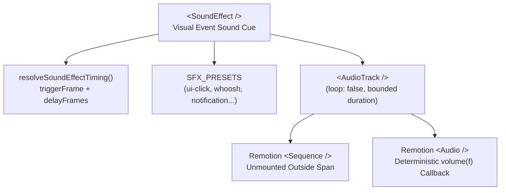

# SoundEffect Component

A production-ready, reusable sound effect component for placing and synchronizing short sound effects within Remotion advertisement compositions.

---

## 1. Overview & Architecture

`SoundEffect` provides a declarative, frame-accurate abstraction built on top of `AudioTrack` designed specifically for short UI interactions, scene transition whooshes, text reveal snaps, and notification chimes.

### Core Principles:
- **Strict Playback Confinement**: Sound effects are strictly confined to their allocated frame window (`loop: false`). Volume is mathematically guaranteed to be `0` before `startFrame` and after `endFrame`, preventing audio leakage.
- **Visual Event Synchronization**: Synchronizes with visual animations like button presses, scene transitions, and card popups via `triggerFrame`, `delayFrames`, or `syncSoundWithTransition`.
- **Procedural Audio Presets**: Includes built-in standard presets (`ui-click`, `whoosh`, `notification`, `pop`, `success`, `error`, `switch`, `shutter`, `impact`) with preconfigured durations, decay envelopes, and preview synthesizer frequencies.
- **Speed & Pitch Control**: Supports `playbackRate` multipliers (0.5x to 2.0x) with optional `preservePitch` toggling (allowing dramatic pitch changes with speed).
- **AdvertisementComposition Integration**: Mounts directly inside `<AdvertisementComposition soundEffects={[...]} />` or as individual components alongside visual scenes.



---

## 2. API Specification

### SoundEffectProps

| Prop | Type | Default | Description |
| :--- | :--- | :--- | :--- |
| `src` | `string` | `SILENT_AUDIO_DATA_URI` | Audio file path, URL, `staticFile` reference, or base64 data URI. |
| `preset` | `SoundEffectPresetName` | `undefined` | Built-in sound preset (`'ui-click'`, `'whoosh'`, `'notification'`, etc.). |
| `id` | `string` | `'sfx'` | Unique identifier for logging and telemetry. |
| `name` | `string` | Preset name or `'Sound Effect'` | Human-readable label for timeline inspection. |
| `triggerFrame` / `startFrame` | `number` | `0` | Composition frame at which the sound effect begins playing. |
| `delayFrames` | `number` | `0` | Frame delay offset added to the trigger frame. |
| `durationInFrames` | `number` | Preset default or `15` | Total playback duration in frames. |
| `endFrame` | `number` | `startFrame + durationInFrames` | Alternative end frame boundary in composition timeline. |
| `volume` | `number \| AudioVolumeFunction` | `1.0` | Base volume multiplier (0.0 to 1.0+). |
| `playbackRate` | `number` | `1.0` | Playback speed multiplier (0.5x to 2.0x). |
| `preservePitch` | `boolean` | `true` | Preserves audio pitch when playback speed changes. |
| `fadeInFrames` / `fadeInDuration` | `number` | Preset default or `0` | Entrance fade ramp duration in frames. |
| `fadeOutFrames` / `fadeOutDuration` | `number` | Preset default or `0` | Exit fade ramp / decay duration in frames. |
| `masterVolume` | `number` | `1.0` | Master multiplier applied on top of final volume. |
| `enabled` | `boolean` | `true` | High-level enable toggle. If false, sound effect is disabled. |
| `disabled` | `boolean` | `false` | Disables sound effect and bypasses audio mounting. |
| `muted` | `boolean` | `false` | Sets audio output to 0 while keeping timing active. |
| `clampToComposition` | `boolean` | `true` | Prevents track from overflowing past composition end. |
| `toneFrequency` | `number` | Preset frequency | Synthesizer test tone frequency in Hz (e.g. 880 for click, 280 for whoosh). |
| `debug` | `boolean` | `false` | Displays visual VU meter telemetry HUD overlay. |
| `showInTimeline` | `boolean` | `true` | Displays sound cue in Remotion Editor timeline. |
| `onVolumeCalculated` | `(metrics) => void` | `undefined` | Telemetry callback fired every frame. |
| `children` | `React.ReactNode` | `undefined` | Optional visual elements rendered alongside the sound. |

---

## 3. Built-In Presets Catalog

| Preset Name | Display Name | Duration | Tone Freq | Envelopes | Common Visual Use Case |
| :--- | :--- | :--- | :--- | :--- | :--- |
| `'ui-click'` | UI Click | 6 frames | 880 Hz (A5) | 0f in / 2f out | Button presses, tab switches, menu toggles. |
| `'whoosh'` | Transition Whoosh | 20 frames | 280 Hz (C#4) | 5f in / 9f out | Scene transitions, slide/wipe sweeps, camera pan. |
| `'notification'` | Notification Chime | 24 frames | 1046 Hz (C6) | 2f in / 12f out | Alert badge popups, card entrance, message received. |
| `'pop'` | UI Pop | 8 frames | 587 Hz (D5) | 1f in / 3f out | Pill badge entrance, heart reaction, micro-interactions. |
| `'success'` | Success Chime | 32 frames | 659 Hz (E5) | 3f in / 16f out | Order complete, form submission, celebration. |
| `'error'` | Error Buzz | 16 frames | 196 Hz (G3) | 2f in / 6f out | Validation failure, incorrect input, alert warning. |
| `'switch'` | Toggle Switch | 5 frames | 1174 Hz (D6) | 0f in / 2f out | Light/dark mode toggle, setting switch. |
| `'shutter'` | Camera Shutter | 10 frames | 740 Hz (F#5) | 1f in / 4f out | Photo snapshot, screen flash, freeze frame. |
| `'impact'` | Dramatic Impact | 28 frames | 130 Hz (C3) | 2f in / 18f out | Product hero reveal, logo slam, title drop. |

---

## 4. Helper Utilities

### 1. `syncSoundWithTransition`
Calculates the exact trigger frame to align a sound effect (like a whoosh) with a scene transition:

```typescript
import { syncSoundWithTransition } from './components/audio';

// Align whoosh with the midpoint of a 20-frame transition starting at frame 60 -> triggers at frame 70
const trigger = syncSoundWithTransition(60, 20, { alignment: 'midpoint' });
```

### 2. `createSoundCue`
Convenient factory for building sound effect cue configs:

```typescript
import { createSoundCue } from './components/audio';

const clickCue = createSoundCue(45, 'ui-click', { volume: 0.9 });
```

---

## 5. Usage Examples

### Example 1: Individual SoundEffect Synchronized with Button Press

```tsx
import React from 'react';
import { staticFile } from 'remotion';
import { SoundEffect } from './components/audio';

export const InteractiveScene: React.FC = () => {
  return (
    <>
      {/* Visual Button Animated at Frame 30 */}
      <MyAnimatedButton triggerFrame={30} />

      {/* Synchronized short click sound effect */}
      <SoundEffect
        preset="ui-click"
        triggerFrame={30}
        volume={1.0}
      />
    </>
  );
};
```

### Example 2: Transition Whoosh with Custom Speed & Pitch

```tsx
import React from 'react';
import { SoundEffect, syncSoundWithTransition } from './components/audio';

export const TransitionScene: React.FC = () => {
  // Scene transition runs from frame 45 to 65 (duration 20 frames)
  const whooshTrigger = syncSoundWithTransition(45, 20, { alignment: 'midpoint' });

  return (
    <SoundEffect
      preset="whoosh"
      triggerFrame={whooshTrigger}
      playbackRate={1.25}      // 25% faster sweeping sound
      preservePitch={false}    // Pitch rises naturally with speed
      volume={0.9}
    />
  );
};
```

### Example 3: Multi-Cue Orchestration with `AdvertisementComposition`

```tsx
import React from 'react';
import { AdvertisementComposition } from './compositions/advertisements/AdvertisementComposition';

export const CommercialAd: React.FC = () => {
  return (
    <AdvertisementComposition
      durationInFrames={180}
      soundEffects={[
        { triggerFrame: 10, preset: 'whoosh' },
        { triggerFrame: 45, preset: 'ui-click' },
        { triggerFrame: 75, preset: 'notification' },
        { triggerFrame: 110, preset: 'switch' },
        { triggerFrame: 140, preset: 'success' },
      ]}
    >
      {/* Visual scenes */}
    </AdvertisementComposition>
  );
};
```

---

## 6. Testing & Verification

Unit tests in `tests/sound-effect.test.ts` verify:
- Accurate `triggerFrame` + `delayFrames` offset calculation.
- Duration resolution from preset or explicit `durationInFrames` / `endFrame`.
- Strict accidental playback prevention (0 volume outside `[startFrame, endFrame)`).
- Envelope ramps (linear fade-in, decay fade-out).
- Speed multipliers and pitch preservation flags.
- Transition alignment logic (`syncSoundWithTransition`).
- All 9 built-in presets parameter validity.
