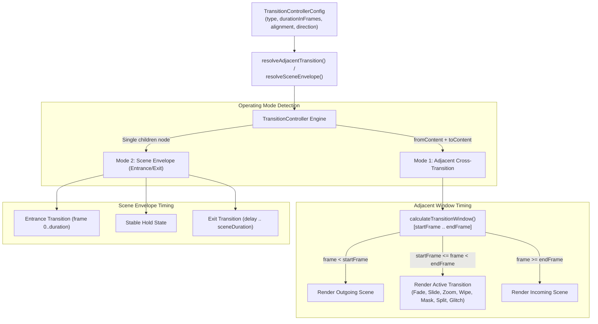

# TransitionController Documentation

`TransitionController` is a centralized, frame-accurate Remotion transition orchestrator that connects the **Transition Library** (`FadeTransition`, `SlideTransition`, `ZoomTransition`, `WipeTransition`, `MaskTransition`, `SplitTransition`, `MorphTransition`, `GlitchTransition`) with scenes, `SceneSequence`, and `AdvertisementComposition`.

It bridges Layer 2 (visual transitions) and Layer 3 (scene library & sequencing), enabling seamless cross-transitions between adjacent scenes as well as entrance and exit envelopes for individual scenes.

---

## 1. Key Capabilities

- **Unified Interface for 8 Transition Engines**: Supports `fade`, `slide`, `zoom`, `wipe`, `mask`, `split`, `morph`, and `glitch` through a standardized configuration model.
- **Dual Operating Modes**:
  1. **Adjacent Scene Transition Mode**: Transitions between an outgoing scene and an incoming scene across a designated `boundaryFrame`.
  2. **Single Scene Envelope Mode**: Wraps a single scene with independent entrance and exit transitions across its lifespan.
- **Frame-Accurate Boundary Alignment**:
  - `center`: Transition window is centered symmetrically around the boundary frame.
  - `lead-in`: Transition window occurs entirely before the boundary frame, finishing as the outgoing scene ends.
  - `lead-out`: Transition window starts at the boundary frame, executing during the start of the incoming scene.
- **Zero-Overhead Bypass & Instant Cuts**: Setting `disabled={true}`, `durationInFrames={0}`, or `type="none"` instantly executes a clean cut without rendering complex masks, filters, or SVG clip-paths.
- **Graceful Error Recovery**: Unrecognized transition strings automatically fall back to standard `fade` with descriptive development console warnings.
- **Deterministic Remotion Lifecycle**: Uses pure integer frame math with `useCurrentFrame()`; completely free of CSS transitions and browser timers (`setTimeout`, `setInterval`, `requestAnimationFrame`).

---

## 2. Architecture & Data Flow



---

## 3. Supported Transition Types

| Type | Underlying Component | Supported Modes & Variants |
| :--- | :--- | :--- |
| `fade` | `FadeTransition` | `crossfade`, `in`, `out`, `in-out` |
| `slide` | `SlideTransition` | `replace`, `enter`, `exit`, directions: `left`, `right`, `top`, `bottom` |
| `zoom` | `ZoomTransition` | `replace`, `in`, `out`, `through`, spring overshoot |
| `wipe` | `WipeTransition` | `replace`, `reveal`, `hide`, edge bar styling |
| `mask` | `MaskTransition` | `replace`, `reveal`, `hide`, geometric shapes & SVG paths |
| `split` | `SplitTransition` | `replace`, `enter`, `exit`, horizontal/vertical panels & strips |
| `morph` | `MorphTransition` | SVG path morphing with color interpolation |
| `glitch` | `GlitchTransition` | `replace`, `in`, `out`, RGB split & displacement slices |
| `none` / `cut` | Direct Render | Instant cut at boundary frame (zero overhead) |

---

## 4. API Reference

### `TransitionControllerProps`

```typescript
export interface TransitionControllerProps extends Partial<TransitionControllerConfig> {
  /** Optional transition configuration object (overrides individual config props) */
  transition?: TransitionControllerConfig;
  /** Outgoing scene element or render node (used in adjacent transition mode) */
  fromContent?: React.ReactNode;
  /** Alias for fromContent */
  outgoing?: React.ReactNode;
  /** Incoming scene element or render node (used in adjacent transition mode) */
  toContent?: React.ReactNode;
  /** Alias for toContent */
  incoming?: React.ReactNode;
  /** Boundary frame between outgoing and incoming scenes (used in adjacent mode) */
  boundaryFrame?: number;
  /** Total scene lifespan in frames (used in single-scene envelope mode) */
  sceneDurationInFrames?: number;
  /** Entrance transition configuration (used in single-scene envelope mode) */
  entrance?: TransitionControllerConfig;
  /** Exit transition configuration (used in single-scene envelope mode) */
  exit?: TransitionControllerConfig;
  /** Explicit current frame override (defaults to useCurrentFrame() in Remotion) */
  currentFrame?: number;
  /** Container inline styles */
  style?: React.CSSProperties;
  /** Container CSS class name */
  className?: string;
  /** Visual debug HUD display */
  debug?: boolean;
  /** Content children: single node for envelope mode, or [outgoing, incoming] tuple for adjacent mode */
  children?: React.ReactNode;
}
```

### `TransitionControllerConfig`

```typescript
export interface TransitionControllerConfig {
  type?: SupportedTransitionType;
  durationInFrames?: number;
  delay?: number;
  mode?: string;
  direction?: SlideDirection | WipeDirection | SplitDirection | string;
  easing?: EasingPresetName | EasingFunction;
  disabled?: boolean;
  alignment?: TransitionAlignment; // 'center' | 'lead-in' | 'lead-out'
  fade?: boolean;
  spring?: boolean | string;
  springPreset?: string;
  overshoot?: boolean;
  reverse?: boolean;

  // Mask Transition
  maskType?: MaskType;
  origin?: string;
  shape?: MaskShape;
  polygonPoints?: string;
  pathData?: string;

  // Split Transition
  splitDirection?: SplitDirection;
  panelCount?: number;
  movementDirection?: SplitMovementDirection;

  // Glitch Transition
  intensity?: number;
  frequency?: number;
  sliceCount?: number;
  rgbOffset?: number;

  // Custom Props
  customProps?: Record<string, unknown>;
}
```

---

## 5. Usage Examples

### Example 1: Adjacent Scene Crossfade

Transitions smoothly between two product scenes across frame 90:

```tsx
import { TransitionController } from './components/transitions';
import { HeroScene, ProductShowcaseScene } from './components/scenes';

export const TwoSceneSpot: React.FC = () => {
  return (
    <TransitionController
      boundaryFrame={90}
      transition={{
        type: 'fade',
        durationInFrames: 25,
        alignment: 'center',
      }}
      fromContent={<HeroScene headline="Antigravity Cloud" />}
      toContent={<ProductShowcaseScene title="Smart Hardware" />}
    />
  );
};
```

### Example 2: Directional Slide Replace with Spring

Replaces the outgoing scene with a directional camera push:

```tsx
<TransitionController
  boundaryFrame={60}
  transition={{
    type: 'slide',
    direction: 'left',
    durationInFrames: 24,
    spring: true,
    overshoot: true,
  }}
  outgoing={<SceneA />}
  incoming={<SceneB />}
/>
```

### Example 3: Cyberpunk Glitch Burst Transition

Adds an energetic digital glitch transition at a scene boundary:

```tsx
<TransitionController
  boundaryFrame={75}
  transition={{
    type: 'glitch',
    durationInFrames: 30,
    intensity: 1.4,
    frequency: 0.8,
    sliceCount: 12,
  }}
  outgoing={<FeatureScene />}
  incoming={<CallToActionScene />}
/>
```

### Example 4: Single Scene Entrance/Exit Envelope

Wraps a scene with entrance zoom-in and exit fade-out:

```tsx
<TransitionController
  sceneDurationInFrames={120}
  entrance={{
    type: 'zoom',
    durationInFrames: 20,
    spring: true,
  }}
  exit={{
    type: 'fade',
    durationInFrames: 15,
  }}
>
  <ProductShowcaseScene title="Next Gen Laptop" />
</TransitionController>
```

### Example 5: Instant Cut (Disabling Transitions)

Easily disable transitions for A/B testing or rapid cuts without rewriting scene JSX:

```tsx
<TransitionController
  boundaryFrame={60}
  transition={{
    disabled: true, // Executes instantaneous cut at frame 60
  }}
  outgoing={<SceneA />}
  incoming={<SceneB />}
/>
```

---

## 6. Integration with SceneSequence & TimelineManager

`TransitionController` powers the transition layer of `SceneSequence`:
- Individual scenes in a sequence declare `transition`, `entranceTransition`, or `exitTransition`.
- `SceneSequence` automatically passes these configs into `TransitionController`.
- Frame calculations match `TimelineManager`'s transition tracks (`calculateSceneTimeline`).

---

## 7. Verification & Quality Gates

The `TransitionController` suite is verified against:
- **Unit Tests**: 23 unit tests in `tests/transition-controller.test.ts` validating type normalization, timing calculations, window boundary logic, and envelopes.
- **Type Safety**: Strictly checked via TypeScript compiler (`tsc --noEmit`).
- **Remotion Bundler**: Verified with `npx remotion bundle`.
- **Interactive Playground**: Tested in `TransitionControllerShowcase.tsx`.
